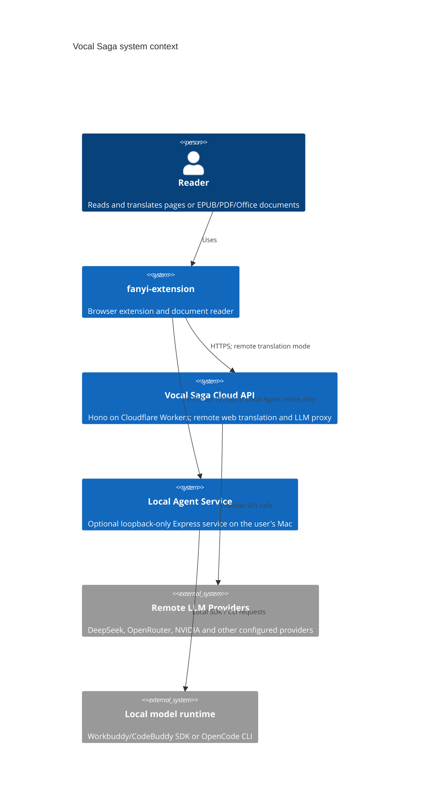
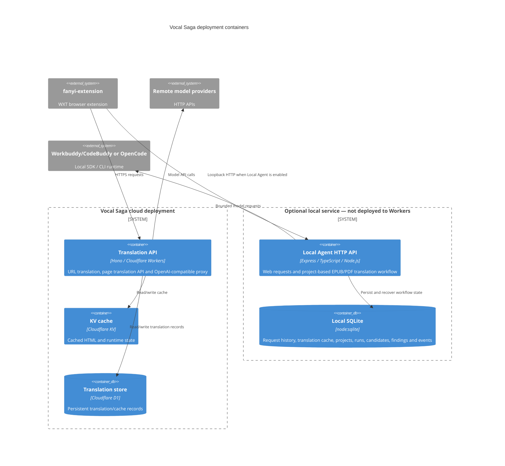
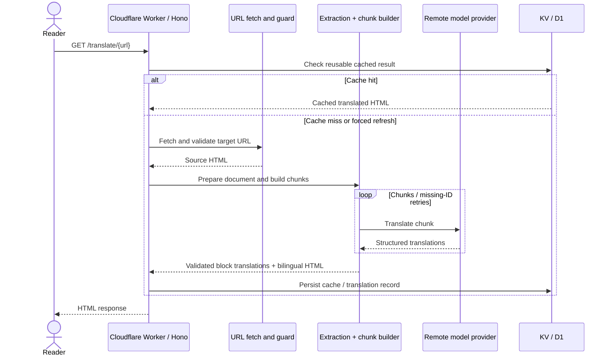
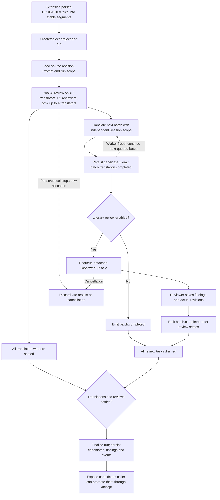

# Vocal Saga

OpenAI-compatible LLM proxy + translation API，部署在 **Cloudflare Workers**。

## Quick Start

```bash
# 安装依赖
npm install

# 本地开发
npm run dev

# 测试
npm test

# 部署
npm run deploy
```

## Endpoints

| Path | 说明 |
|------|------|
| `/translate/<url>` | 翻译页面（浏览器直访） |
| `/force/<url>` | 强制重新翻译 |
| `/openrt/<url>` | OpenRouter 免费模型翻译 |
| `/nvd/<url>` | NVIDIA kimi-k2.6 翻译 |
| `/nvd/deepseek/<url>` | NVIDIA deepseek-v4-pro 翻译 |
| `/original/<url>` | 原始页面（不翻译） |
| `/o/<url>` | /original 别名 |
| `/api/v1/chat/completions` | LLM 代理（需 auth） |
| `/api/instapaper/save` | 保存文章到 Instapaper（需 AUTH_KEY） |
| `/api/instapaper/connect` | 发起 Instapaper OAuth（需 AUTH_KEY） |
| `/instapaper` | Instapaper OAuth callback：`https://s.sunxiunan.com/instapaper` |

## Tech Stack

- **Hono** — CF Workers 原生运行
- **linkedom** — 纯 JS DOM 解析
- **DeepSeek / OpenRouter / NVIDIA** — LLM API
- **Cloudflare KV** — 缓存存储
- **Cloudflare D1** — 翻译结果持久化

## Architecture and request flows

### C4 — system context



### C4 — containers and persistence



### Sequence — remote URL translation



### Flow — local EPUB/PDF Agent run



> The Cloudflare API and Local Agent are separate routes. Enabling Local Agent mode does not fall back to remote providers on local model failure. Worker caps are bounded by `LOCAL_AGENT_POOL_SIZE`, and every batch has an independent Session scope.

## Configuration

```bash
# 设置 secrets
wrangler secret put DEEPSEEK_API_KEY
wrangler secret put OPENROUTER_API_KEY
wrangler secret put NVIDIA_API_KEY
wrangler secret put AUTH_KEY
wrangler secret put INSTAPAPER_ACCESS_TOKEN
# 如需 OAuth 连接/切换账号，再设置下面两项：
wrangler secret put INSTAPAPER_CLIENT_ID
wrangler secret put INSTAPAPER_CLIENT_SECRET
```

Instapaper OAuth 应用的 Callback URL 需精确配置为 `https://s.sunxiunan.com/instapaper`。如果已经通过 OAuth 连接账号，`VOCAL_SAGA_KV` 中的授权 token 优先使用；否则回退到 Cloudflare Secret `INSTAPAPER_ACCESS_TOKEN`。浏览器只会调用 Vocal Saga API，不会获得 Instapaper token。

## Testing

```bash
npm test              # Vitest
npm run build:lib     # 编译 lib/
npm run typecheck     # 类型检查
```


## Local Agent Service（macOS）

除部署到 Cloudflare Workers 的远程翻译 API 外，仓库还提供一个独立的本机 Express + TypeScript Provider，供 `saga/fanyi-extension` 将请求转交给本机 Workbuddy/CodeBuddy SDK 或 OpenCode CLI。服务使用 SQLite 记录请求历史，与 Cloudflare Worker 部署解耦。

启动步骤：进入 `local-agent-service`，运行 `npm install` 和 `npm start` 即可；`.env` 是可选的，只有需要覆盖运行时默认设置时才复制 `.env.example`。`LOCAL_AGENT_TOKEN` 可留空；服务仅监听 loopback，并拒绝普通网页来源。如需额外客户端校验，可设置随机 Token 并在扩展中填写相同值。

服务默认监听 `http://127.0.0.1:8789`。需要 Node.js >= 22.13，详细设置、SQLite 存储和隐私选项见 [local-agent-service/README.md](local-agent-service/README.md)。也可从仓库根目录运行 `npm run local-agent:install`、`npm run local-agent:start` 和 `npm run local-agent:test`。该服务仅面向本机使用，不随 Cloudflare Worker 一起部署。每次请求会记录 request ID、provider/model、耗时和错误堆栈；`LOCAL_AGENT_LOG_RESPONSE_PREVIEW=false` 可关闭无效 JSON 响应预览。扩展启用本机 Provider 后，模型失败会直接报错，不会切换到远程 API。
