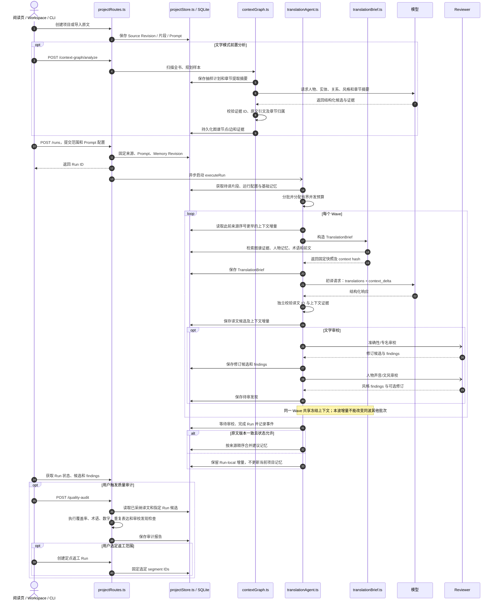

# vocal-saga Local Agent Service 翻译质量与预处理架构审查

- 日期：2026-10-17
- 审查范围：当前 `main` 分支的 `local-agent-service`，重点包括项目 API、`translationAgent.ts`、`translationBrief.ts`、`translationContextDelta.ts`、`bookScan.ts`、`contextGraph.ts`、`voiceContext.ts`、`literary.ts`、`qualityAudit.ts` 和 `projectStore.ts`
- 目的：记录现状、标明可以用传统代码改善的质量环节，并给出分阶段实施顺序
- 边界：本文是架构与代码审查，不宣称尚未执行的改造已提升真实模型译文质量

## 1. 总体结论

当前系统已经具备项目级 Run、SQLite 持久化、不可变原文版本、Prompt/记忆版本、结构化模型输出、TranslationBrief、人物与关系上下文、独立准确性和文风审校、选择性返工以及全书质量审计。它不是简单的逐段 Prompt 包装器。

最大的改进空间不在于继续堆叠 Agent，而在于提高前置扫描和实体提及的召回率、让重复表达检查比较正确的语言单位、扩大可确定验证的源文约束，并建立真实模型输出的前后对照。

需要区分三个层次：

1. **可验证的工程事实**：片段 ID、来源版本、引文范围、输出完整性、数字/单位候选检查、已确认术语是否出现。
2. **有证据但仍需语义判断的候选**：人物身份、别名、说话人、关系、语气、含义与上下文。
3. **整体译文质量**：忠实度、自然度、风格、节奏和文学效果。自动指标只能帮助排序和审查，不能单独证明译文更好。

## 2. 当前 Local Agent Service 完整流程

文学模式包含全书预处理、项目翻译 Run 和独立质量审计。技术文档等非文学模式可以跳过书籍级人物分析，但仍使用同一 Project/Run 调度和持久化边界。

### 2.1 流程图

```mermaid
flowchart TD
    U["阅读页 / Agent Workspace / CLI / Project API"]
    API["projectRoutes.ts：统一项目 API"]
    CREATE["创建 Project，解析/导入文档"]
    STORE["SQLite：Source Revision、片段、Prompt、记忆版本"]
    MODE{"文学翻译模式？"}

    U --> API --> CREATE --> STORE --> MODE
    MODE -- 是 --> SCAN["bookScan.ts：全文扫描实体/句子/对白/数量线索"]
    SCAN --> INDEX["SQLite：book-scan-index-v2，按 source revision 持久化"]
    INDEX --> SAMPLE["planBookSamples：基于带位置的索引选择最多 72 个样本"]
    SAMPLE --> ANALYZE["Context Graph 模型分析"]
    ANALYZE --> VALIDATE["校验样本 segment ID 和原文引文"]
    VALIDATE --> GRAPH["保存图谱、关系、章节摘要和证据"]
    GRAPH --> GATE{"当前来源版本与语言的预处理可用？"}
    GATE -- 否 --> STOP["拒绝启动文学翻译"]
    GATE -- 是 --> RUN
    MODE -- 否 --> RUN["POST /runs"]
    RUN --> SNAP["固定原文、Prompt、基础记忆版本和范围"]
    SNAP --> EXEC["translationAgent.ts：executeRun"]
    EXEC --> ITEMS["读取待译/失败片段并按源序排列"]
    ITEMS --> BATCH["buildBatches：按数量、字符预算和章节边界"]
    BATCH --> WAVE["构建有界 Wave 与冻结上下文"]
    WAVE --> BRIEF["translationBrief.ts：构建有预算、按序过滤的上下文"]
    BRIEF --> SAVEBRIEF["保存 TranslationBrief 快照、哈希和统计"]
    SAVEBRIEF --> TRANS["初译：translations + 可选 context_delta"]
    TRANS --> OUTPUT["校验 ID、重复/未知 ID、空译文与缺失片段"]
    OUTPUT --> RETRY{"缺失片段且重试仍可用？"}
    RETRY -- 是 --> TRANS
    RETRY -- 否 --> CANDIDATE["保存候选译文"]
    TRANS --> DELTA["独立验证上下文增量与译文落点"]
    DELTA --> DELTASAVE["保存已验证增量和诊断事件"]
    CANDIDATE --> REVIEW{"文学审校启用？"}
    REVIEW -- 是 --> ACC["准确性/术语 Reviewer"]
    ACC --> STYLE["人物声音/文风 Reviewer"]
    REVIEW -- 否 --> WAVEEND
    STYLE --> WAVEEND["批次结果与审校任务结束"]
    CANDIDATE --> WAVEEND
    DELTASAVE --> WAVEEND
    WAVEEND --> MORE{"还有后续批次？"}
    MORE -- 是 --> WAVE
    MORE -- 否 --> DRAIN["等待未结束的 Reviewer"]
    DRAIN --> FINISH["计算 Run 最终状态并持久化事件"]
    FINISH --> VALIDREV{"Run 状态和来源版本允许合并？"}
    VALIDREV -- 是 --> MEM["候选合并到项目文学记忆，仍为 suggested"]
    VALIDREV -- 否 --> LEDGER["保留 Run 增量，不写入当前项目记忆"]
    MEM --> RESULT["候选、审校发现、事件与版本结果"]
    LEDGER --> RESULT
    RESULT --> AUDIT["独立质量审计"]
    AUDIT --> REPAIR["按 findings/segment IDs 创建定点返工 Run"]
    REPAIR --> RUN
```

### 2.2 时序图

### 2.3 主要模块职责

| 模块 | 目前职责 |
|---|---|
| `projectRoutes.ts` | Project/Run、文件导入、Context Graph、记忆、采纳、质量审计与定点返工 API |
| `bookScan.ts` | 全文启发式姓名候选、章节/对白分布、重复句候选、样本计划 |
| `contextGraph.ts` | 对有限样本进行模型分析，验证引用后持久化图谱和章节摘要 |
| `translationAgent.ts` | 分批、初译、结构校验、上下文增量校验、Reviewer 调度、Wave 和持久化边界 |
| `translationBrief.ts` | 依据来源 ordinal 和字符预算构造每批不可变上下文 |
| `translationContextDelta.ts` | 验证当前批次证据、提及的译文落点、候选合并 |
| `voiceContext.ts` / `literary.ts` | 人物声音、角色关系语言规则、声音锚点与文学审校 |
| `qualityAudit.ts` | 缺译、已确认术语漂移、数字/单位差异、重复表达、审校发现和上下文冲突 |
| `projectStore.ts` | 原文/PROMPT/记忆版本、运行状态、译文候选/采纳、人工作业与事件持久化 |

## 3. 代码中已经存在的限制

### 3.1 预处理使用全文启发式扫描，但模型分析只看到有限样本

`bookScan.ts` 将全文切片扫描后，`planBookSamples` 默认最多选取 72 个样本，每个样本文本最多 850 字符。抽样涵盖文档开头/中部/结尾、章节分布、出现频繁且跨章节的姓名候选、重复表达及对白密集片段。这是合理的预算控制，但不是完整的全书实体分析。未被抽样的角色、别名或关系可能不会进入图谱。

姓名提取目前主要依赖英语大写字母模式。特殊大小写、非英语名字、姓名缩写、连字符、带撇号形式以及“冠词 + 称谓”组合，都会影响召回或规范化。姓名、称谓和实体共现也还没有形成统一的全量位置索引。

### 3.2 重复表达质量审计可能比较了错误的语言单位

`qualityAudit.ts` 用扫描到的重复源表达定位多个 segment，再将这些 segment 的完整译文作为不同变体比较。如果重复短语位于较长段落内部，段落前后文不同会导致整段译文不同，即使重复短语本身译得一致。没有可靠的短语对齐时，这种差异不应被直接解释成短语译名漂移。

### 3.3 上下文增量证据已经验证，但还未充分利用提及索引

`translationContextDelta.ts` 会验证 entity candidates 的原文证据和 entity mention 的译文落点。然而，已验证的 `entity_mentions` 尚未充分用于跨片段规范译名一致性审计。建议将它与候选实体、别名及来源位置关联，支持更精确的跨章节发现。

### 3.4 质量检测是风险提示，不是自动证明

数字/单位、术语和重复表达检查能定位需要复核的问题，但它们不完整覆盖否定、情态、指代和句子极性。审校 Reviewer 的 finding 也仅覆盖实际执行过的审校范围；没有产生 finding 不等于不存在错误。

### 3.5 评测基线尚不能证明真实模型质量提高

`evaluate-fiction-quality-baseline.mjs` 及小说 fixture 能重现缺译、术语漂移、重复表达不一致、后文泄漏和数量错误。但仓库测试明确说明所谓“improved example”是人工编制的样例，而不是模型实际输出。因此测试证明检查器能处理这些案例，不证明最近改动已经提升真实翻译质量。

## 4. 建议的技术改进

### M1：确定性检测与回归测试

1. 修正姓名扫描对冠词/称谓词的处理；保留复合称谓候选，同时保留它在源文中的具体位置，避免一刀切丢弃含停用词的候选。
2. 修正重复表达审计的比较粒度。整段源文完全重复时可以比较完整译文；仅在长片段内部重复的句子/引语应优先提取并比较对应目标语引语，无法可靠对齐时只做人工复核提示，不能把整段差异当成确定的短语漂移。
3. 利用已校验的 `entity_mentions` 为有明确来源证据的实体映射生成跨批次表面译名不一致 finding；不得凭子串模糊匹配合并实体。
4. 将普通 Run/Prompt 请求与显式记忆编辑彻底分开；服务端保证旧客户端记忆快照不能隐式覆盖当前记忆版本。
5. 为上面每个规则添加独立的回归 fixture，并验证报告不会改写已采纳译文。

### M2：全文索引与预处理增强

1. 建立来源版本固定的片段特征索引：实体/称谓候选及字符偏移、句子范围、对白/引号范围、重复表达位置、数字/数量单位线索。
2. 改善姓名提及采集：Unicode 规范化、连续大写专名、多词名称、标题/称谓前缀、连字符和所有格，同时保留候选原始表面形式与位置。
3. 让自适应抽样直接使用实体的完整 occurrence 列表，而不是只依赖有限的 segment ID 预览；对于重要候选，抽取早期/中期/后期证据，并按章节平衡而非仅按照一个全局名称分数排序。
4. 选择性地把完整的实体提及统计、抽样覆盖率及索引策略版本持久化，保证可以解释“为什么选择这些段落”。模型结论仍必须引用实际提供给模型的样本文本。
5. 用同一索引为翻译检索和质量审计提供来源位置，减少不同模块各自用不同正则重复扫描所产生的结果偏差。

### M3（本报告不实施）

建立 Source Invariants，扩展否定/情态、结构标记、数量语义和可控局部修订验证。

### M4（本报告不实施）

固定来源、语言、模型与 segment 范围，开展真实翻译 A/B 测试和盲评。

### M5（本报告不实施）

在高风险片段上试验 COMET/QE 或候选比较；只有在证明收益后才增加额外模型成本。

## 5. 研究与开源实现参考

以下是用于架构参考的论文、项目和技术工具；它们提供设计线索，不等于对任何项目生产质量的独立认证。

- **FolioLoom**：<https://github.com/daanaagua/FolioLoom>。长篇翻译使用冻结命名目录、带来源定位的命名提议及局部修订，提示我们应该把命名提及和修改落点保持在源位置上，避免全局字符串替换。
- **Prozetta**：<https://github.com/UrgenProchnoff/prozetta>。将书籍级术语/叙述风格决策与局部翻译分开，并以审校与人工接受队列管理候选。
- **Ollama Translator**：<https://github.com/minyiyang/ollama-translator>。可参考阶段检查点、术语/格式一致性检查、恢复和有界修复思路。
- **ContextWeaver**：<https://github.com/FIERsity/ContextWeaver>。使用稳定片段 ID、上下文包、版本化译文和结构/术语审计，适合作为设计参考；其成熟度不应被视作已验证生产标准。
- **COMET**：<https://github.com/Unbabel/COMET>。提供基于模型的翻译评价与质量估计工具，适合未来用于风险排序；不宜将其分数当作文学翻译的最终判决。
- **QE-Fusion**：关于融合质量估计信息进行翻译候选选择的研究方向，可作为高风险片段候选比较的后续研究，而不是当前阶段的必要依赖。
- **Context Is Ubiquitous, but Rarely Changes Judgments**，WMT 2025：<https://aclanthology.org/2025.wmt-1.5/>。研究指出上下文虽常见，但并非所有上下文都会改变人工评价；工程上应提升相关性和检索命中，而不是单纯扩大上下文。
- **How Good Are LLMs for Literary Translation, Really?**：<https://arxiv.org/abs/2410.18697>。文学翻译自动评分与人工判断之间的关系有限，进一步支持保留盲评和人工接受机制。

## 6. 实施验收标准

### M1 验收

- [ ] 复合姓名/称谓候选不会仅因含有冠词等停用词被整体丢弃。
- [ ] 重复表达审计不会把包含相同引用的完整长段落差异直接当作该引用译法不一致。
- [ ] 已验证 entity mentions 可参与跨批次不一致检查；证据不充分时只提示，不自动合并/改写。
- [ ] 普通 Prompt/Run 调用不能隐式覆盖服务端文学记忆。
- [ ] 审计、返工和评测均不直接覆盖已采纳/人工译文。

### M2 验收

- [ ] 全文扫描产出可追溯到 source revision、segment ID 和字符位置的实体/句子/对白/数量特征。
- [ ] 抽样由完整的提及索引驱动，仍严格受样本数和单样本文本预算限制。
- [ ] 预处理事件或持久化记录包含策略版本、候选数、覆盖计数和采样原因。
- [ ] 测试覆盖复合称谓、别名分散、对白跨章、重复短语和后文身份信息边界。
- [ ] 单元测试和类型检查通过；质量收益需要之后真实模型 A/B 和盲评验证，不在本报告中预先宣称。

## 7. 交付边界

本文件记录代码审查、当前限制和实施顺序。只有代码变更、回归测试以及实际质量评估结果分别得到验证后，才能把对应项标记为已完成；不应将计划或人工构造 fixture 的分数当作真实模型质量收益。

## 8. M1/M2 实施记录（2026-10-17）

以下是已经提交到 `main` 的实现状态。CI 验证以本节更新时最新运行的结果为准；代码/确定性测试通过不等于已证明真实 LLM 的整体译文质量提升。

### M1：确定性检测与回归

- **姓名和称谓扫描**：`bookScan.ts` 保留 `The King`、`The King Rat`、`Captain Vale` 等多词/带称谓词候选及其原文位置；名称出现按表面形式分桶，避免对全文 mention 数组按每个候选重复扫描。
- **重复表达审计**：完整源句仅在源片段本身就是该句时比较完整译文；重复引语优先提取并比较目标语引语内容。无法可靠对齐的嵌入表达显示为 `repeated-expression-alignment-review`，不直接视作已证明的译法漂移。
- **实体提及漂移**：已经过 `context_delta` 验证的 `entity_mentions` 参与跨片段表面译名检查；只按规范名称/明确别名关联，不以模糊子串合并实体。目标表面形式变化仅生成审查 finding，不自动统一译文。
- **记忆写入边界**：普通 Prompt revision/Run 请求不能用内嵌的旧 `literaryMemory` 覆盖服务端记忆；项目创建期间仍允许一次性迁移旧阅读器记忆，随后通过显式 `/literary-memory` 更新。
- **回归覆盖**：增加复合姓名/称谓、重复引用对齐、显式实体提及漂移、记忆显式写入边界的测试。

### M2：全文特征索引和预处理

- **源特征索引**：`bookScan.ts` 全文扫描实体/称谓、句子/引语、对白信号及数量/单位候选，附带 segment ID、字符偏移和规范表面形式。
- **持久化索引**：`contextGraph.ts` 将特征写入 SQLite `context_graph_source_features`，以 source revision 和 segment ID 为键，并保存 `book-scan-index-v2`、覆盖数与截断标记。读取时检查版本及片段完整性。
- **旧项目兼容**：新增无模型调用的惰性索引升级。已有项目缺失索引时，首次批次检索或质量审计会通过确定性扫描补建，不必重跑书籍分析 LLM；完整索引通过轻量版本/行数检查后复用。
- **自适应抽样**：书籍分析提示包含只属于模型实际输入文本的候选名称表面形式与偏移，继续保持 72 个样本、每样本 850 原文字符的预算，不把未提供给模型的段落当成可引用证据。
- **同一索引被审计复用**：重复表达审计优先从持久化句子/引语范围构建候选组，旧/不完整索引会回退到同一确定性扫描算法。报告记录所用索引版本及覆盖片段数。
- **可观测性**：扫描事件包含实体/文本单元/数量特征计数、截断状态和索引策略版本；惰性升级另记录 `context-graph.source-index.ready` 事件。

### 当前验证边界

已为索引持久化、旧项目惰性升级、复合称谓和精确字符偏移、重复引语对齐、实体提及漂移和记忆写入边界增加自动化测试。提交 `18ebd617996771aa2e7436c65714b7b73ad0d392` 的 Local Agent Service workflow 与仓库 CI 均通过，包括测试、TypeScript 类型检查、小说质量回归 fixture 和 library build（[CI 记录](https://github.com/devweekly/vocal-saga/actions/runs/39009541500)）。这些结果验证确定性规则与工程边界，不证明真实模型译文整体质量已经提升；真实翻译 A/B 与盲评属于 M4，尚未作为 M1/M2 完成声明。
