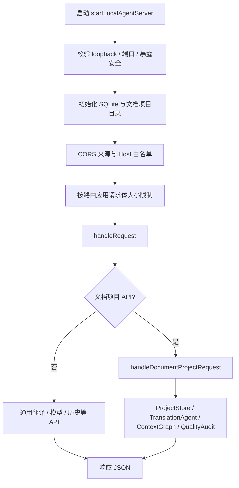
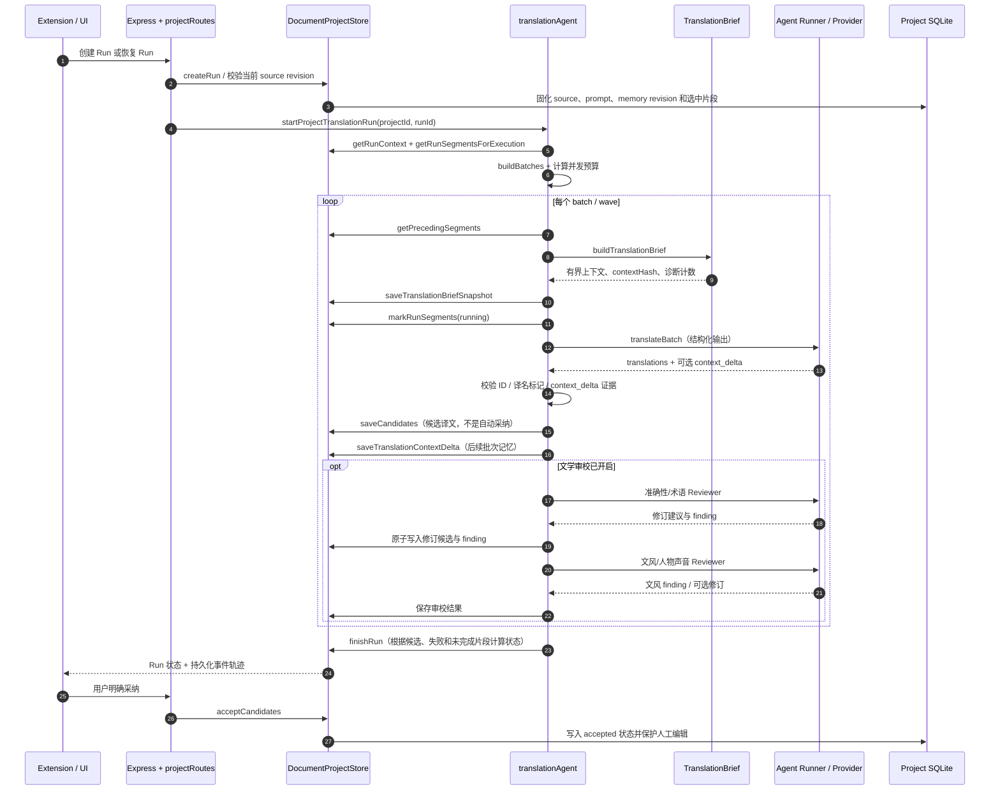
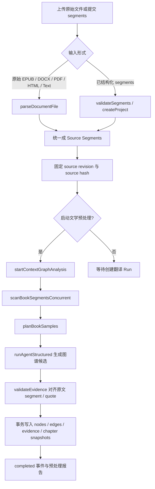
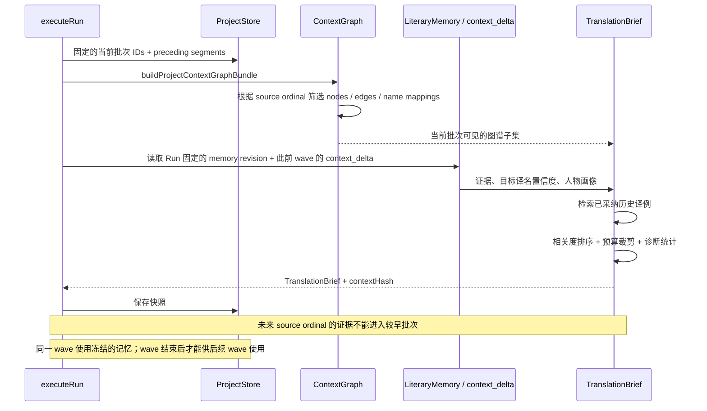
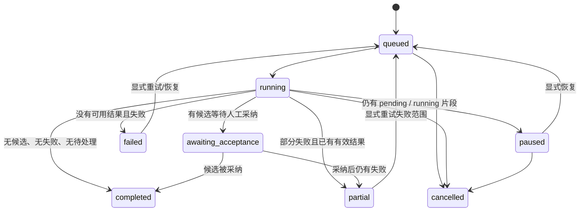

# Local Agent Service 架构与关键函数导航

本文面向维护 `local-agent-service` 的开发者。重点不是罗列全部函数，而是说明模块职责、关键调用链、持久化边界，以及修改一个行为时应该从哪里入手。流程以当前 `main` 分支为准。

## 1. 模块职责

| 模块 | 关键入口 | 责任边界 |
|---|---|---|
| HTTP 服务与安全 | `src/server.ts:startLocalAgentServer`、`src/routes.ts:handleRequest`、`src/middleware.ts:authorize` | 监听本机地址、请求体限制、来源/Host 校验、Token 校验及路由分发 |
| 文档 API 适配层 | `src/documents/projectRoutes.ts:handleDocumentProjectRequest` | 校验 HTTP 输入、调用 Store/Agent、返回状态；不直接承载工作流状态逻辑 |
| 持久化与状态机 | `src/documents/projectStore.ts:DocumentProjectStore` | 来源/Prompt/记忆版本、Run 与片段状态、候选/已采纳译文、事件轨迹、审计快照 |
| 翻译编排 | `src/documents/translationAgent.ts:executeRun`、`translateBatch` | 切批、并发预算、停止边界、模型重试、审校、候选写入和最终 Run 状态 |
| 模型执行适配 | `src/agents/runner.ts:runAgent`、`runAgentStructured` | 将任务路由给 Workbuddy 或 OpenCode，统一结构化输出入口与日志 |
| 文档抽取 | `src/documents/ingest.ts:parseDocumentFile` | 将原始文件转成带稳定 ID、章节路径和结构元数据的 Source Segment |
| 确定性原文索引 | `src/documents/bookScan.ts:scanBookSegmentsConcurrent`、`planBookSamples` | 并发构建词项/对白/重复表达/数量等特征，按证据分布制定抽样计划；不把词面统计当作事实 |
| 文学上下文图谱 | `src/documents/contextGraph.ts:startContextGraphAnalysis`、`runAnalysis`、`buildProjectContextGraphBundle` | 异步预分析、证据校验、图谱持久化，并按当前批次时间边界构建局部图谱 |
| 动态记忆合并 | `src/documents/translationContextDelta.ts:validateTranslationContextDelta`、`mergeTranslationContextDeltasIntoMemory` | 校验当前批次给出的证据与译文落点，合并为后续 wave 可见的候选记忆 |
| 人物声音 | `src/documents/voiceContext.ts:buildProjectVoiceContext` | 从当前文本、可见前文及有证据的对白锚点检索相关角色与关系规则 |
| 质量审计 | `src/documents/qualityAudit.ts:runProjectQualityAudit`、`createQualityRepairRun` | 确定性检查、汇总 Reviewer 发现、生成新返工 Run；不自动覆盖已采纳译文 |

## 2. 服务启动与请求分发

安全校验顺序很重要：请求来源和 Host 检查发生在读取较大请求体之前；服务仍只监听 loopback。若配置了允许通过隧道或反向代理访问的 Host，就必须同时配置 Token。不要为了支持浏览器网页来源而放宽 CORS。

## 3. 文档翻译主流程

### 关键边界

- **Run 创建先于后台执行**：持久化 Run 和选中片段后才调用 `startProjectTranslationRun`。后台工作不是 HTTP 请求生命周期的一部分。
- **候选译文与已采纳译文分离**：`saveCandidates` 写入本次 Run 的候选；只有明确采纳或人工编辑才改变已采纳译文。审校可改进候选，但不绕过采纳门槛。
- **状态转换以 SQLite 为准**：内存中的 `activeRuns` 只用于本进程去重，不是持久化状态来源。服务重启后应从 Store 恢复状态或重试失败范围。
- **停止边界是写入边界**：模型调用前、调用返回后、候选写入前都需要再次检查 Run 状态；数据库事务还会拒绝在取消/暂停后提交迟到结果。
- **审校不是翻译成功的前置条件**：审校失败会写入 warning，并保留有效初译候选。审校修订和 supporting findings 应一起原子提交。
- **上下文快照可追溯**：同一批次的初译和 Reviewer 使用同一份 TranslationBrief；保存的 revision IDs、hash 和字符数用于审计，不代表完整模型请求的全部长度。

## 4. 文档抽取与预处理

预处理分为两个不同职责：`bookScan.ts` 是确定性、低成本的原文特征索引与抽样规划器；`contextGraph.ts` 通过模型分析选中的原文样本，但模型输出只能成为候选，服务端会重新验证证据。候选图谱不是可直接信任的全书真相，也不应绕过按批次的时间边界。

## 5. Context Graph 与 TranslationBrief 如何协作

修改上下文相关代码时，尤其要保证这些输入使用同一个 `sourceRevisionId`：当前批次、前文、术语、Context Graph 证据、人物声音证据、已采纳译例与动态记忆。全书模型分析得到的候选目标，不能只凭规范名称曾经出现过就升级为强约束。

## 6. 状态与持久化模型

这里是概念状态图，具体允许的转移以 `DocumentProjectStore.setRunStatus`、`finishRun`、`acceptCandidates` 的校验为准。取消和完成是不可被迟到 worker 反向覆盖的终态；暂停/部分失败可以通过明确操作恢复。新的源版本会有新的 revision ID 和 segment hash，旧 Run 不应被重新解释为当前源版本的 Run。

主要持久化对象：

| 存储对象 | 作用 |
|---|---|
| `source_revisions` / `source_segments` | 不可变来源版本、稳定 segment ID、ordinal、章节路径与源文 hash |
| `prompt_revisions` / `literary_memory_revisions` | 固定本次运行使用的 Prompt 与文学记忆版本 |
| `translation_runs` / `run_segments` | Run 状态、范围、候选引用及片段级进度 |
| `translation_results` | 初译/审校候选、人工编辑、采纳状态与 source hash |
| `project_events` | 流程轨迹、阶段事件、告警、失败与诊断信息 |
| `translation_briefs` / context-delta 记录 | 可追溯上下文快照和供后续 wave 使用的候选记忆 |
| Context Graph 表 | 节点、关系、原文证据、章节摘要与预处理运行状态 |
| 质量审计 / 对照评测表 | 审计报告、返工依据与盲评结果 |

## 7. 关键函数索引与维护提示

| 函数 | 主要职责 | 改动时必须复核 |
|---|---|---|
| `startLocalAgentServer` | 服务装配和安全启动 | loopback 绑定、CORS/Host 顺序、请求体上限、重启恢复 |
| `handleRequest` / `handleDocumentProjectRequest` | API 路由与参数校验 | 不把业务状态逻辑放到 HTTP 层；错误状态码与旧项目/旧版本处理 |
| `parseDocumentFile` | 统一导入入口 | 文档格式、压缩展开上限、段落/章节路径、稳定 ID |
| `scanBookSegmentsConcurrent` / `planBookSamples` | 特征扫描与采样 | worker 与同步实现结果一致；offset/segment ID 始终指向原文 |
| `startContextGraphAnalysis` / `runAnalysis` | 异步预处理生命周期 | 同一项目单活动分析、source revision pinning、证据白名单和事务提交 |
| `buildProjectContextGraphBundle` | 每批次检索图谱 | 时间边界、目标语言、别名可见性、证据引用与预算 |
| `createRun` / `getRunContext` | 运行初始化和版本固定 | 不把当前最新 Prompt/记忆偷偷套到旧 Run |
| `executeRun` | Run 级调度与状态收尾 | 并发预算、停止边界、失败片段、wave 记忆冻结及最终状态 |
| `translateBatch` / `parseTranslations` | 一次模型翻译调用与响应校验 | ID 覆盖/重复/未知 ID、规范译名标记、提示词与上下文快照 |
| `runLiteraryReviewWithMissingRetry` | 审校补全和保护 | 只补缺失 ID；保留规范译名；失败不应撤销初译 |
| `saveCandidates` / `acceptCandidates` | 候选提交与显式采纳 | 原子事务、source hash、人工编辑优先、取消后的迟到写入 |
| `appendEvent` / `saveTranslationBriefSnapshot` | 可观测性和上下文审计 | 事件可重放/可轮询；快照 revision ID 必须与 Run 一致 |
| `validateTranslationContextDelta` / `mergeTranslationContextDeltasIntoMemory` | 增量记忆校验与合并 | 原文证据属于当前输入；候选状态不能伪装为已确认事实 |
| `buildProjectVoiceContext` | 人物声音检索 | 证据不足时不猜说话人；不能因画像状态高就随机注入 |
| `runProjectQualityAudit` / `createQualityRepairRun` | 问题发现与范围化返工 | 报告与当前 source revision 一致；返工仍是新 Run，需人工采纳 |

## 8. 调试顺序

遇到“译文不一致、上下文缺失或用户停止后状态异常”时，建议按以下顺序定位：

1. 先确认 `runId`、`sourceRevisionId`、`promptRevisionId` 和 `literaryMemoryRevisionId`，排除读错版本。
2. 查 `project_events` 中的 `plan.ready`、`translation-brief.ready`、`batch.prompt.ready`、`stage.warning` 和终态事件。
3. 对照 `translation_briefs` 快照中的 `contextHash`、`contextChars`、注入计数和排除/裁剪诊断。
4. 检查候选译文是否提交、是否仍为候选、是否因人工编辑保护而没有覆盖已采纳结果。
5. 最后检查 Provider/模型执行记录。不要先把所有问题归因于模型；先确定错误来自输入上下文、状态边界、输出结构还是模型判断本身。

相关背景文档：`TRANSLATION_PIPELINE.md`、`STRUCTURED_DOCUMENT_TRANSLATION.md`、`NON_LLM_PERFORMANCE.md`，以及 `local-agent-service/AGENTS.md`。
