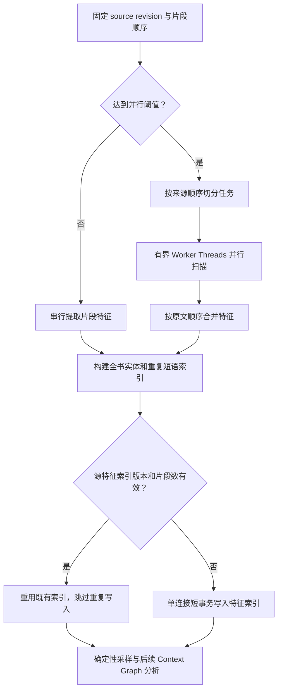

# Local Agent Service 非 LLM 性能审计与并发策略

**审计日期：** 2026-10-17  
**范围：** `local-agent-service` 的文档导入、书籍预处理、特征索引、翻译编排、质量审计、SQLite 持久化和 HTTP/SSE 路径。  
**边界：** 本次没有本机真实书籍的 profiling 数据。因此本文区分已经确认的代码开销、已实施的优化和仍需基准验证的候选项；不预报未经测量的加速倍数。

## 结论

非 LLM 工作不应统一改成多线程。网络和文件等待优先使用异步 I/O；独立且 CPU 密集的纯计算适合 Worker Threads；共享 SQLite 写入、任务状态转换、来源版本检查和依赖前后顺序的合并仍应由服务主线程协调。

第一轮已将书籍特征扫描拆为片段级纯计算任务，针对较大输入以最多 4 个 Worker 执行，并按来源顺序合并。小文档沿用串行实现，避免线程启动和结构化克隆开销。索引版本与片段数匹配时，重用已存在的不可变源特征索引，避免每轮预处理重复重写相同索引。扫描耗时与索引复用状态进入 `context-graph.scan.completed` 事件。

## 预处理执行路径



## 模块审计

| 模块 | 当前特征 | 并发决策 | 后续依据 |
|---|---|---|---|
| `documents/bookScan.ts` | 多次遍历每个片段，提取实体候选、句子/引语、对话与数量特征；全书名称和重复短语需要完整语料汇总 | **已实施 Worker Threads**：大文档的片段级抽取并行；全书聚合仍在主线程并保持确定性顺序。引语跨度去重改用 Set | 运行 `npm run benchmark:book-scan -- 3200 3`；再使用真实大型 EPUB/TXT 样本测量 |
| `documents/contextGraph.ts` | 扫描后构建采样输入，再进行单次全书结构化模型分析；特征索引持久化是同步数据库工作 | **已实施索引复用**；只有模型依赖完整全书证据的阶段才保留全局串行边界；数据库写入不移到 Worker | 看 `scanDurationMs` 和 `sourceFeatureIndexReused` 事件字段；另行测量索引持久化耗时 |
| `documents/ingest.ts` | 支持 EPUB/DOCX/HTML/Markdown/TXT 和文本层 PDF；ZIP 解压与部分内容处理使用同步 CPU/API，PDF 提取涉及子进程 | 暂不把整个导入流程搬进线程。单个大文件可能阻塞事件循环，但需测量导入时主线程延迟；若热点集中在纯文本/ZIP 解析，再提取无状态解析 Worker | 用最大支持输入测量导入总耗时、Event Loop Delay、峰值 RSS；保留文件大小与解压大小限制 |
| `documents/translationAgent.ts` | 已具备有限任务调度 `runWithConcurrency`、停止分配新批次和等待在途工作收敛的语义 | 保留现有有界并发。不要为增加并发而改变模型 Session 池容量、章节顺序、停止/暂停或提交语义 | 分别观察翻译批次等待时间、Session 池利用率和失败恢复 |
| `documents/qualityAudit.ts` | 质量审计与修复涉及持久状态、证据及多步校验 | 不并行化共享数据库写入或同一对象的状态变更；未来可将纯规则计算与 I/O 分离，再独立并行计算 | 用耗时分布区分 SQL 等待、JSON 处理、规则计算和报告构造 |
| `projectStore.ts`、`db.ts` | SQLite `DatabaseSync`、WAL、事务和同步 SQL 调用 | 写事务必须短且协调；不要多个 Worker 共享同一 DatabaseSync 句柄。并行计算后统一批量提交 | 监控事务时长、锁等待、SQL 往返与重复序列化 |
| Express 路由、请求体和 SSE | 部分 I/O 已是异步流式操作 | 网络等待优先 async I/O，不需要为了“并发”普遍改为多线程 | 以请求延迟、事件循环延迟和 SSE 更新延迟定位阻塞 |
| 缓存、JSON 与其他纯函数 | 单次调用常较轻；大对象序列化可能占 CPU/内存 | 不先加 Worker；优先避免重复计算、缩小复制对象和减少数据库往返 | 结合 CPU profile 与 heap/RSS 数据决定是否升级 |

## 已落地的控制与一致性约束

- 默认最多使用 4 个书籍扫描 Worker，实际默认并发不超过 `availableParallelism() - 1`。
- 对不足 12,000 个片段且总字符数低于 1,000,000 的书籍，默认使用串行扫描；显式设置 Worker 环境变量或测试覆盖参数时可强制执行并行路径。
- `VOCAL_SAGA_BOOK_SCAN_WORKERS=0` 关闭 Worker；设置为 `1` 强制串行；设置为 `2` 至 `4` 指定并行 Worker 数。
- Worker 只计算片段级特征，不读写 SQLite，也不修改项目状态。全书名称候选、重复短语和采样在主线程汇总。
- 合并按原文片段顺序执行，保留来源 UTF-16 偏移、采样理由、截断上限和确定性结果。测试比较串行与 Worker 输出的完整对象。
- Worker 初始化或计算失败时，本轮预处理失败并记录错误，不悄悄把线程失败伪装成成功结果。

## 验证流程

先运行：

```bash
npm run typecheck --prefix local-agent-service
npm test --prefix local-agent-service
npm run benchmark:book-scan --prefix local-agent-service -- 20000 4
```

基准脚本会对同一合成语料跑串行和 Worker 扫描，报告两者耗时、比值及结构结果是否完全一致。合成语料仅用于快速回归，不代表真实书籍加速结果。上线评估还应使用小、中、大三类实际来源版本，在相同 Node.js/机器环境下至少重复多轮，比较中位耗时、峰值内存、Event Loop Delay 和结果哈希。

### 当前 CI 的单次合成基准记录

| 输入 | 串行 | Worker 并行 | 串行/并行耗时比 | 结果一致 |
|---|---:|---:|---:|---|
| 3,200 片段 / 291,026 字符 / 3 Workers | 180.76 ms | 386.54 ms | 0.47×（并行更慢） | 是 |
| 20,000 片段 / 1,818,866 字符 / 4 Workers | 1,719.44 ms | 1,270.23 ms | 1.35× | 是 |

数据来自 GitHub Actions 的 Node.js v22.13.0 各一次合成运行，未多轮取中位数。基于两组数据，默认阈值调整为 12,000 片段或 1,000,000 字符；显式 `VOCAL_SAGA_BOOK_SCAN_WORKERS` 设置仍可用于诊断与人工调优。应使用实际书籍重复测量后再调整阈值。

## 下一阶段建议

1. **导入路径 profiling**：重点看同步 ZIP 解压、HTML/XML 清理和大文件解析是否阻塞 API/SSE。
2. **持久化耗时**：测量特征索引 JSON 序列化与批量写入。只有数据库写入确认是瓶颈时，再优化 schema、批次和事务；增加线程无法提高单写者吞吐量。
3. **质量审计纯计算提取**：将规则校验与读取/写入分离；只对 CPU 热点使用 Worker，对共享状态仍使用主线程短事务。
4. **真实语料基准后再调阈值**：不要因一次合成测试就提高默认 Worker 数，也不要把单线程下的线程启动开销扩散到所有文档。
