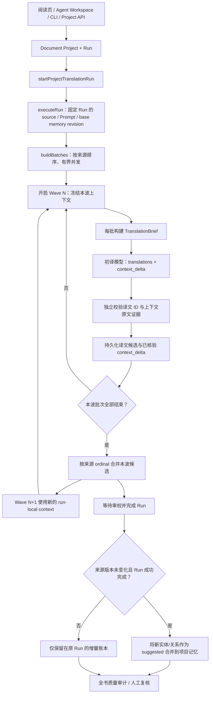

# Local Agent 文档/小说统一翻译 Pipeline

- 状态：当前实现说明
- 适用范围：`local-agent-service` 的项目级 EPUB/PDF/长文档与小说翻译
- 决策记录：[ADR-0001：统一本地翻译管线与初译上下文增量](adr/0001-unified-local-translation-context-delta.md)

本文说明本地文档翻译的统一执行路径，以及初译阶段如何返回并动态更新人物、实体和其他上下文。根目录 Cloudflare Worker 的短文本/网页翻译仍属于独立运行时，不应把长任务 Agent 编排移入 Worker。

## 1. 统一入口与责任边界

阅读页（包括“继续翻译下一待译页”和“强制重译当前页”）、Agent Workspace、CLI 和项目 API 都必须走同一个 Document Project / Run 执行器。入口可以选择当前页、章节、显式片段、全部或待更新片段等范围，但不能自行执行第二套本地翻译循环。

| 层 | 责任 |
|---|---|
| `fanyi-extension` 阅读页 / Agent Workspace | 展示文件和双语内容；选择范围；发起或停止 Run；呈现持久化进度、候选和审计结果 |
| Project API / CLI | 创建或恢复 Project/Run，校验请求和操作权限；不直接生成另一份翻译实现 |
| `translationAgent.ts` | 统一调度、批次切分、模型请求、响应校验、候选保存、审校、上下文增量合并、停止/恢复边界 |
| `translationBrief.ts` | 为每批构造有预算、来源版本固定、按原文序号过滤的只读上下文快照 |
| `translationContextDelta.ts` | 证据核验、增量合并、冲突保留；模型提出的任何事实都保持候选状态 |
| `projectStore.ts` | SQLite 事实来源：Run/片段状态、TranslationBrief、上下文增量、候选译文及项目记忆 revision |
| `qualityAudit.ts` | 全书缺失、术语/重复表达问题和不同批次候选译名冲突的审计入口 |



统一的是项目、调度、持久化、恢复、输出校验、审校、候选和审计契约；不要求小说、技术文档和短文本使用相同 Prompt。任务类型差异以同一执行器中的显式策略表达，不能按 UI 入口分叉。文学上下文增量对文学模式生效，非文学请求继续使用相同结构化翻译和候选生命周期，但不会把普通术语或代码片段强行建模成人物关系。

## 2. 初译响应契约

文学初译除必需的 `translations` 外，还应返回有界的 `context_delta`。例子中的字段采用 snake_case，是模型协议的一部分；服务端将其验证后转换为内部类型。

```json
{
  "translations": [
    {
      "id": "segment-17",
      "translated_text": "国王朝麦克斯投去凶狠的一眼。"
    }
  ],
  "context_delta": {
    "entity_candidates": [
      {
        "local_id": "king",
        "canonical_source": "The King",
        "aliases": ["King"],
        "kind": "character_epithet",
        "target_proposal": "国王",
        "evidence": [
          {
            "segment_id": "segment-17",
            "quote": "The King shot a murderous glance at Max."
          }
        ],
        "reason": "同一称谓需要在后续片段中保持稳定译法"
      }
    ],
    "entity_mentions": [
      {
        "segment_id": "segment-17",
        "source_quote": "The King",
        "entity_ref": "king",
        "target_surface": "国王"
      }
    ],
    "relationship_deltas": [],
    "open_questions": [],
    "conflicts": []
  }
}
```

| 字段 | 用途 | 接受条件 |
|---|---|---|
| `entity_candidates` | 新人物、称谓、地点、物件、群体或别名的译名候选 | 当前批次的原文引文真实存在；规范来源名称出现在证据引文中；别名需有当前批次证据 |
| `entity_mentions` | 记录某个实体在具体片段中的来源表达和译文表面形式 | segment ID 属于当前输入；原文引文真实存在；`target_surface` 实际出现在同一片段的译文中 |
| `relationship_deltas` | 候选人物关系变化 | 证据片段存在，且关系双方名称都能在该源片段定位；关系语义仍是待核验候选 |
| `open_questions` | 保留身份、称谓、指代或上下文上的不确定点 | 问题必须关联可核验的当前批次来源证据 |
| `conflicts` | 显式报告本批发现的解释/映射冲突 | 冲突需有来源证据；合并时保留为待核验信息 |

`context_delta` 中的模型状态、置信度或“已确认”字样都不具有授权效力。项目级记录统一保留为 `suggested/candidate`，人工确认仍使用现有记忆审核入口。

上下文元数据与译文分开验收。缺失、截断或无效的 `context_delta` 会被丢弃并记录诊断，但只要 `translations` 本身通过结构校验，译文仍然保存。这保证上下文抽取质量不佳时不会连带丢掉有效的初译。

## 3. 验证与动态合并策略

### 3.1 证据核验

`translationContextDelta.ts` 按以下规则校验上下文增量：

1. 引用的 `segment_id` 必须属于本次模型请求的当前 `segments`，不能引用 `precedingSegments`、后续批次或任意书籍位置。
2. `quote` 必须是对应原文片段内能匹配的连续文本；仅有模型解释或无法核验的引文不接受。
3. 候选规范名称必须出现在它自己的证据引文中；别名必须能在本批原文证据中定位，避免仅凭相似拼写把两个角色合并。
4. `entity_mentions.target_surface` 必须出现在该 segment 的实际返回译文中。未命中的 mention 不作为已核验落点。
5. 关系候选必须带来源证据，而且双方名称在引文所在的原文片段中都能定位。这个确定性检查不能证明谓词语义正确，因此关系不会自动确认。
6. 每批各类记录都有数量和字符串长度上限。超出上限、结构错误或无效证据按记录丢弃，生成计数诊断，不覆盖有效译文。

### 3.2 波次边界

不能在全局并行批次之间立即更新共享内存，否则模型响应的完成先后将决定其他批次的知识，造成不可复现的译名，也可能把后文信息泄漏给原文顺序更早的批次。因此执行器把批次划分为有界 wave：

- 在每一波开始时，读取此前已有的 context-delta 记录，筛选首片段来源 ordinal 严格早于本波首片段的增量，并从 Run 的基础记忆构建本波上下文。
- 同一波中的批次并行运行，所有批次看到相同的上一波记忆快照。某个批次先结束并不能影响本波另一个批次。
- 每个批次仍按相同的 TranslationBrief 策略构建上下文快照。初译和两个 Reviewer 共用各自批次的同一快照；Reviewer 不读取下一波或实时变更的记忆。
- 本波完成后读取持久化的增量，按原文来源 ordinal 排序合并，再启动下一波。
- 暂停或进程重启后，Run 的 context-delta 账本可用于重新构建下一波记忆。若恢复后前面的片段先补译，已经保存的后文增量不会提前注入；只有其来源 ordinal 确实位于当前批次之前时才可见。

### 3.3 冲突优先级与持久化

合并遵循明确顺序：

1. 人工确认的规范译名、别名和关系不会被模型候选改写。
2. 相同来源实体且目标译名相同的候选可以增加有证据的别名或补充候选关系。
3. 同一来源实体出现不同候选译名时，保留原有/来源顺序中的首个目标，记录明确的 open question；禁止静默覆盖或全局替换。
4. 名称相同不等于实体相同。合并只根据明确的 source/alias 集合重合以及兼容的实体类型进行，不使用任意子串模糊匹配。
5. 每个批次的已验证增量写入项目 SQLite 的 `translation_context_deltas` 表，幂等键为 `(run_id, first_segment_id)`，同时保存 `batch_index`、来源 ordinal、来源片段 ID、增量 JSON、验证计数及时间。重试同一批时可更新这一批的记录，其他批次记录不删除。
6. 只有 Run 成功完成且项目当前来源 revision 仍与 Run 一致时，才把最终候选合并进当前文学记忆 revision。新增实体和关系同时保留 `evidenceRefs: [{ segmentId, sourceQuote }]`。每次构建 TranslationBrief 时，实体/关系证据都必须通过来源版本、segment ID、引文匹配和 ordinal 过滤；不能因为同一称谓在早期出现过，就把后文才有证据的映射注入早期片段。新增数据仍为 suggested；来源已经改变或 Run 中断时不把旧证据写入全局记忆，而保留在原 Run 的账本里。

项目记忆合并只更新可复用的结构化候选，不直接改写历史译文。全局质量审计新增 `context-delta-conflict` finding，用于定位多个批次提出的冲突译名；finding 是人工审查入口，不自动启动返工，也不自动应用译文修改。

## 4. 事件与可观测性

与增量相关的事件包括：

| 事件 | 主要字段 |
|---|---|
| `translation.context-delta.parsed` | 本次请求接受/拒绝的实体候选、提及、关系、问题和冲突计数 |
| `translation.context-delta.saved` | 批次首片段、来源片段数量、已持久化候选计数、是否可供后续 wave 使用 |
| `translation.context-wave.ready` | wave 序号、首来源 ordinal、可见的前序增量数量、候选数量、策略标识 |
| `translation.context-memory.persisted` | 新 memory revision、合并摘要、候选/关系冲突计数 |
| `translation.context-memory.skipped` | Run 与当前 source revision 不一致时的跳过原因 |
| `translation.context-memory.unchanged` | 本轮没有产生新的可持久化候选时的原因 |

事件记录计数和版本，不记录完整原文、完整译文或整个模型 Prompt。精确的来源引文仅在项目的上下文增量账本中与 Run/segment ID 一起保存，继续遵循本机文档数据的存储范围。

## 5. 质量门与回归测试

新增/更新的验证重点：

- `tests/translation-context-delta.test.mjs`：当前批次证据约束、伪造/越界引文拒绝、译文表面形式核验、已确认译名保护、冲突候选的确定性合并。
- `tests/document-agent-prompt.test.mjs` 与 `tests/translation-brief.test.mjs`：检查 TranslationBrief 的时间边界、共享快照、Prompt payload，以及 dynamic entity evidence 不得向早期 segment 泄漏。
- `tests/quality-audit.test.mjs`：既有全书缺译、确认术语漂移和重复表达审计，并覆盖 context-delta 冲突 finding。
- `npm test`：运行本地服务完整回归集；`npm run quality:fiction-baseline`：运行小说质量控制样本。

测试夹具证明确定性验证和边界行为，不代表真实模型翻译质量已经提高。质量收益仍需在同一 source revision、语言方向和相同 segment 集合上进行 before/after 对照，并结合人工检查人物身份、称谓和声音是否稳定。

## 6. 不在本次架构内的事情

- 不在 Cloudflare Worker 内执行书籍级多阶段 Agent 或持久化 Context Graph。
- 不在 `fanyi-extension` 里复制 `context_delta` 校验、实体合并和持久化逻辑。
- 不做跨全文本字符串替换，不因自动建议而改写已采纳译文。
- 不把模型生成的人物身份、关系、别名或译名直接标为 confirmed。
- 不让同波批次相互观察尚未完成的增量，也不把后文证据注入早期原文片段。
