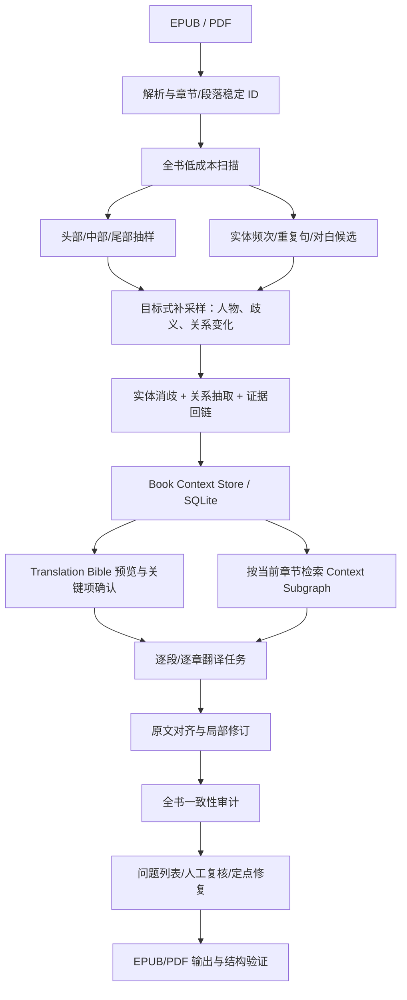

# 小说 EPUB / PDF 翻译：整书预分析与 Context Graph 研究报告

**检索日期：2026-10-16**  
**研究范围：** 开源小说翻译器、整书预分析 / lore bible / Translation Bible、人物关系图、文档级文学翻译研究、可落地的工程设计。

## 1. 结论先行

有，而且已有几个开源项目非常接近这个方向。不过，需要把三种不同能力分开：

1. **整书预分析（book-level pre-pass）**：在正式翻译前，先理解全书，提取角色、别名、设定、语气和风格。
2. **可检索的 Context Graph / Lore Bible**：把人物、称谓、事件、关系、风格与原文证据组织成结构化资料，后续翻译时按需读取。
3. **逐段/逐章翻译与全书一致性审查**：实际翻译仍按适当大小的上下文进行，再用全书规则发现名字漂移、角色称谓混乱、重复台词翻译不一致等问题。

公开项目里最值得重点研究的是：

- **[epublate](https://github.com/madpin/epublate)**：最贴近“先看全书不同位置，再形成翻译资料”的思路。项目有每本书独立的 lore bible、SQLite 持久化、辅助模型 intake / pre-pass；其文档还明确实现了从 EPUB 的**开头、中间、末尾抽样**来预判作品语气，再选择风格预设。
- **[llm-LN-translator](https://github.com/thang97-21/llm-LN-translator)**：结构化 context 最丰富。每卷生成 `context.xml`，其中包含 `character_roster`、`name_map`、`relationship_graph`、`voice_fingerprints`、`eps_arc_tracker`、`scene_plans`、`verbatim_anchors` 等，并把跨卷记忆存为 JSON 文件。它更接近“小说翻译专用上下文模型”，但 README 中一些能力是项目作者定义的功能，不能据此断言已通过独立质量基准验证。
- **[Novel_Analysis](https://github.com/olivelb/Novel_Analysis)**：重点在 EPUB/PDF/TXT/MOBI 的人物、地点、关系、主题和人物传记抽取，并提供交互式知识图谱。它的价值是“如何提取和消歧图谱”，不是成熟的翻译流水线。
- **[ollama-translator](https://github.com/minyiyang/ollama-translator)**：有书级术语一致性审查、style sheet、章节故事摘要和可恢复的分阶段流水线。其文档同时提供了重要的负面经验：story-context 阶段虽已实现为可选功能，但作者记录的两组基准没有观察到可测量收益，因此没有建议默认开启。
- **[ArmenianLitTranslator](https://github.com/Edmon02/ArmenianLitTranslator)**：README 描述了在正式翻译前生成 Translation Bible，包含角色档案、术语表、风格、主题和母题；每章翻译再配合前章摘要与质量审查。适合参考整体流程，但需要自行核查代码深度和实际效果。

**核心建议：** 不要在每一章开始时才临时让模型猜人物，也不要把全书所有文本不加区分地塞进每个翻译请求。更合理的方案是：**全书扫描 + 分层抽样 + 重点实体补采样 → 建立有原文证据的上下文图谱 → 人工确认关键规则 → 按当前章节检索相关上下文 → 分段翻译 → 全书一致性审计。**

另外，`context graph` 不必一开始就上 Neo4j 或专门图数据库。对单机小说翻译，**SQLite 表 + JSON 结构 + 原文位置索引 + 可选全文/向量检索**，通常更轻、更容易持久化和调试。图谱应是上下文的结构化来源；每次发送给 LLM 的，是从图谱中筛出的短小 Translation Brief。

---

## 2. 开源项目调查

以下根据项目公开 README / 文档判断其公开宣称的能力。除特别说明外，这不是对每个仓库逐文件审计，也不是对翻译质量的独立基准测试。

| 项目 | 预分析方式 | 上下文表示 | 翻译时怎样使用 | 对本方案的价值 / 限制 |
|---|---|---|---|---|
| [epublate](https://github.com/madpin/epublate) | 新建项目时可做 book intake；批量翻译前可做实体 pre-pass；tone sniff 从 EPUB 开头/中间/末尾抽样 | 每本书独立 lore bible；实体可处于 proposed / confirmed / locked 等状态；SQLite 保存决定和调用记录 | 逐 segment 翻译，使用风格预设和已确认术语；支持验证与受影响内容重译的设计 | **最直接匹配分层抽样 + 预分析 + 可确认的翻译资料。** EPUB 优先；项目明确 PDF 不在 v1 范围内。抽样 tone sniff 和全书实体 intake 是两件事，不应混为一谈。 |
| [llm-LN-translator](https://github.com/thang97-21/llm-LN-translator) | 先 extract，再跑缓存的多轮 prep；文档描述为多轮结构化准备，使用整卷原文、已有系列 bible 和可用的检索证据 | `context.xml`：人物、命名、关系图、角色 voice fingerprints、文化术语、情感/剧情弧、scene plans、固定表达等；跨卷另有 `term_lock.json`、`verbatim_anchors.json`、`series_pack.json` | 每章翻译都接收准备好的上下文；保留近章上下文；存在独立 QC 与 EPUB build | **最完整的小说翻译上下文 schema 参考。** 它把人物关系、角色语气、固定译法和系列延续分开建模。项目相对小众，建议借鉴数据结构与阶段划分，不要把 README 描述直接当成质量证明。 |
| [Novel_Analysis](https://github.com/olivelb/Novel_Analysis) | 解析 EPUB/PDF/TXT/MOBI；spaCy 做实体线索，LLM 批次抽取，再做别名/重复实体合并和关系补全 | 人物、地点、关系、主题概念、人物传记组成交互式知识图谱，并保存原文片段作为证据 | 主要用于浏览和分析图谱；不是以章节翻译为中心的产品 | **适合作为实体消歧、关系抽取、证据回链和图谱可视化参考。** 不应期待它直接提供成熟的翻译上下文路由、译文质量控制或 EPUB 输出流程。 |
| [ollama-translator](https://github.com/minyiyang/ollama-translator) | 先提取/确认 glossary；可选地为每章生成源文摘要；之后翻译、审查、修复、再验证 | 术语表、书级 style sheet、章节 summary、整书重复句和称谓一致性报告 | 每段/每 chunk 带入相关术语和风格条目；可检查跨章人名、重复句、他/她/它、你/您及标点 | **很值得参考的工程化 QA 设计。** 文档称 story-context 已实现但为可选阶段，并记录其两组基准未见可测量收益，因而不建议默认开启。提醒我们必须做对照测试，而不是因为“多了上下文”就认定质量更好。 |
| [ArmenianLitTranslator](https://github.com/Edmon02/ArmenianLitTranslator) | 全书分析后形成 Translation Bible | 角色档案、glossary、风格、主题和母题；另有章节摘要 | 每章输入 Bible、前章摘要及近期章节；独立 critic 按多维度评估并可触发修订 | **概念与流水线很贴近目标。** 但“RL-inspired”等名称不能证明真有强化学习；在采用前应读实现、测试和许可，不宜只看 README 的描述。 |
| [novel-translator](https://github.com/andrian531/novel-translator) | 由模型抽取人物、地点、术语；滚动生成章节摘要 | 人物资料（年龄、性别、别名、关系）、逐书风格指南、章节摘要 | 每次请求注入人物资料、前章摘要和当前 chunk 的邻近上下文 | 适合作为简化版实践参考；公开描述重点在网文逐章翻译，不等于完整图谱。 |
| [Universal Novel EPUB Translator](https://github.com/stenlysayd/novel_epub_translator) | 文档称会分析早期章节，识别类型、语气、人物、阵营和设定 | 按项目隔离的实体表、术语表、类型适配提示 | 在翻译中注入上下文，并进行 XML/DOM 修复 | 适合参考项目隔离与类型化风格提示。公开仓库较小；“early chapters”策略不能代替对中后段关系变化的抽样。 |
| [Tolmach / book-translator](https://github.com/KazKozDev/book-translator) | 翻译前扫全书并提出人物、地点、组织和术语 glossary，等待用户确认 | glossary + genre/style + chunk 状态和检查结果 | 分块翻译；改进模型提出局部修订；独立 verifier 检查提议；标记遗漏、数字变化和术语违规 | **适合作为翻译前术语审阅、局部修订验证和人工复核的参考。** 主要上下文机制是 glossary 与邻段，并非完整人物关系图。采用时要考虑其 AGPL-3.0 许可。 |
| [AI EPUB Translator](https://github.com/g-battaglia/ai-epub-translator) | 术语表准备；更重视结构验证 | glossary、段落级任务及缓存 | 模型只看普通文本和占位符；原始 EPUB XHTML、脚注、链接和格式由代码保留；做单元验证和章节评估 | **格式保护非常值得借鉴，但不是 Context Graph 项目。** 可用于理解格式/内容解耦与可恢复任务。 |
| [Paladin's Rise](https://github.com/ginstrom/paladin-novel) | 项目先构建人物、世界观、章节大纲和连续性资料 | glossary、翻译备注、角色 voice 资料、worldbuilding 文档 | 使用 reviewer、planner、translator 多角色协作翻译完整小说 | 这是一个展示 LLM 辅助小说创作与翻译文档工作方式的项目，不是通用翻译应用。适合看人如何维护可读的角色/世界观资料。 |

### 2.1 最值得读的几个实现

**第一优先：epublate。** 它的 `docs/PRD.md` 把数据状态、人工确认、风格预设、批量翻译、失败恢复和 EPUB 格式保护说得比较清楚。一个重要细节是：其“开头/中间/末尾抽样”主要被用于项目创建前的 tone sniff；另有独立的整书 intake / batch pre-pass 用于提出实体候选。实现时应保留这种职责区分，而不是把少量抽样直接称为“已经理解全书”。

**第二优先：llm-LN-translator。** 它的 `context.xml` 定义是目前调查中最接近小说专用 Context Graph 的公开例子：人物、别名映射、关系、角色语气、固定表达、情节弧和场景规划在同一卷级上下文中关联；系列资料则跨卷复用。即便不照搬多轮 prompt 或其具体 provider 代码，这套字段划分值得参考。

**第三优先：ollama-translator 的 `BOOK_CONSISTENCY.md`。** 它把问题拆得很清楚：glossary 负责固定译名；style sheet 负责语气、代词、称谓和重复表达；story context 负责“前文发生了什么”；translation memory 负责重复原文的译法一致；book-level audit 负责找出跨章节漂移。这比把所有要求都堆进一段 prompt 更容易测试和维护。

**第四优先：Novel_Analysis。** 它有较完整的“章节化 → 实体抽取 → 名称/别名消歧 → 关系抽取 → 证据片段 → 人物传记 → 图谱展示”数据流。如果想做可视化的人物关系图，可以借鉴；如果只为改善翻译，不必一开始引入完整图谱 UI。

---

## 3. 研究文献说明了什么

### 3.1 文档级上下文会改善文学翻译，但不能替代审校

**Karpinska & Iyyer，WMT 2023：** [Large Language Models Effectively Leverage Document-level Context for Literary Translation, but Critical Errors Persist](https://aclanthology.org/2023.wmt-1.41/)。研究比较了 18 种语言方向，发现让 LLM 一次翻译完整文学段落，相比逐句翻译，在误译、语法和风格一致性上表现更好。论文同时报告仍存在严重问题，包括内容遗漏；作者声音是否保留也仍需要人类翻译者介入。

**对设计的含义：** 不要把小说拆成完全无联系的单句；翻译单元应尽量保留自然段/对话轮次/段落组。但“给模型更多文本”并不能保证它不会漏句，也不保证人物声音准确。

### 3.2 小说里的实体、术语、指代和引语要分别测量

**Jiang 等，ACL 2023：** [Discourse-Centric Evaluation of Document-level Machine Translation with a New Densely Annotated Parallel Corpus of Novels](https://aclanthology.org/2023.acl-long.435/)。该研究为小说语料加入实体、术语、共指和引语四个维度的细粒度标注，涵盖两种语言中 15,095 个实体提及；研究指出机器翻译输出与人类译文的篇章结构存在实质差异。

**对设计的含义：** Context Graph 不应只有“人物 A 和 B 是朋友”。还要覆盖：同一实体出现了哪些别名、某个代词/称谓指向谁、人物是否在说话、话是谁说的、同一术语在哪些章节出现、引用/重复台词是否稳定。审计也要按这些类别输出，而不是只评一个总分。

### 3.3 上下文不是越长越好，关键是检索正确的信息

**Herold & Ney，CODI 2023：** [Improving Long Context Document-Level Machine Translation](https://aclanthology.org/2023.codi-1.15/)。论文回顾了常见的局部上下文做法，指出只使用前一两句话，通常不足以覆盖文档级主题或风格；但把上下文持续扩展也会造成内存负担，性能还可能退化。作者研究了将注意力集中到更相关内容的方案。

**对设计的含义：** 不建议每次都把整本小说、所有人物简介和全部章节摘要重发给模型。应该有全书资料层，但运行时只检索当前段落真正相关的实体、关系、语气样本和“截至当前章”的故事摘要。

### 3.4 2026 年研究支持“先文档级翻译，再局部细化”

**Tan 等，ACL 2026：** [What Does LLM Refinement Actually Improve? A Systematic Study on Document-Level Literary Translation](https://aclanthology.org/2026.acl-long.268/)。研究覆盖 6 个 LLM、7 种语言方向、多种细化粒度与策略。论文报告的稳健做法是：**先做文档级翻译，再进行 segment-level refinement**；单纯做 document-level refinement 改进更小或更不稳定。细化带来的收益主要在流畅度，忠实度提升有限。

**对设计的含义：** 先为译文提供篇章上下文，再针对具体段落修正更值得投入；不应把整书再让模型“润色一遍”当作主质保手段。修订必须和原文对齐，并保护原意与内容完整性。

### 3.5 文学翻译不能只用一般 MT 指标判好坏

**Zhang、Zhao、Eger，NAACL 2025：** [How Good Are LLMs for Literary Translation, Really?](https://aclanthology.org/2025.naacl-long.548/)。研究构建了文学段落翻译评测语料并比较人工、专业人员和自动评估方法。论文发现，评估方案复杂度和评估者经验会显著影响结果；较复杂的 MQM 方案在其文学评测设置中并不理想，自动指标也很难可靠识别文学翻译的优劣。研究的总体结论是，已出版的人类译文在质量和表达多样性方面仍优于所测试的 LLM 译文。

**Zhang 等，EMNLP 2025：** [LiTransProQA](https://aclanthology.org/2025.emnlp-main.1482/)，提出把专业文学翻译者的判断纳入问答式评价，关注文学手法、文化理解和作者声音。它强调：通用流畅度分数不能覆盖文学翻译真正重要的维度。

**对设计的含义：** 角色 voice 不能只靠“语言自然度 1–10 分”评判。应加入原意、作者声音、人物之间的声线区分、文化语境、文学修辞和文本完整性；最好用人工盲选对比而不只是让同一个模型打分。

### 3.6 旁证：长叙事的一致性问题往往不是平均分布的

**Lost in Stories: Consistency Bugs in Long Story Generation by LLMs（2026）**，[arXiv](https://arxiv.org/abs/2603.05890) 研究的是长篇故事生成，不是翻译，不能直接作为翻译效果证据。但它发现，长叙事的一致性错误经常涉及事实和时间维度，并且在叙事中段较容易出现。这个结果为“不要只看开头”提供了旁证：抽样应覆盖中段，也应围绕实体变化和事实冲突自适应补采样。

---

## 4. 应怎样理解 Context Graph

建议不要把 Context Graph 理解成一张漂亮的人物关系图，也不要把它等同于向量数据库。对翻译有用的图谱需要回答的问题包括：

- 这个名字/称谓/昵称到底指谁？是否与其他名字是同一实体？证据出现在哪里？
- 这个角色在当前章节与谁讲话、关系是什么、当前应当使用什么称谓/礼貌程度？
- 角色在不同时期的语气是否发生变化？哪些原文对白能够代表其声线？
- 某个术语、口头禅、诗句或反复出现的表达，前面采用过什么译法？这一次是否有意变化？
- 当前章节以前已经发生了什么？有哪些未解决的线索？哪些后续真相当前绝不能提前透露给翻译模型？
- 哪个上下文判断有原文证据，哪个只是模型推测，哪个已经由用户确认？

### 4.1 建议的数据对象

| 对象 | 主要字段 | 翻译用途 |
|---|---|---|
| `Entity` | `id`、类型、规范名称、别名、首次/末次出现位置、重要性、置信度 | 统一人物、地点、组织、物品、称谓和世界观术语 |
| `Mention` | 实体 ID、原文写法、章/段/字符位置、局部句子、识别方法 | 让模型和用户能回到原文核查；帮助处理同名、昵称和代词 |
| `Relation` | 主体、关系类型、客体、有效章节范围、置信度、证据 | 表示亲属、上下级、阵营、敌对、称呼习惯和关系变化 |
| `ChapterSummary` | 章节 ID、人物、事件、状态变化、未闭合线索、摘要来源 | 提供有限的“截至当前章节发生了什么” |
| `VoiceProfile` | 角色 ID、正式度、词汇倾向、句式、口头禅、礼貌/粗俗程度、代表性原文样本 | 保持人物说话方式的区别，而不是把所有对话润成同一种风格 |
| `StyleGuide` | 叙述者声音、目标译文风格、对话标点、称谓和人称规则、翻译策略 | 保持全书的整体文学风格与排版习惯 |
| `TermLock` | 原文形式、规范译法、允许变体、词性/语义、适用范围、状态 | 对必须固定的专名/术语进行硬约束 |
| `PhraseAnchor` | 原文重复句、已选译文、所有出现位置、是否允许语境变体 | 固定口头禅、重复台词、诗歌和回环表达 |
| `Evidence` | 原文片段、位置、抽取时间、模型/规则、置信度、确认状态 | 防止无证据的模型“脑补设定”成为后续翻译规则 |

### 4.2 关系类型不要只有人物关系

建议至少包括：

- `alias_of`：昵称、姓氏、头衔、旧名指向同一实体。
- `appears_in` / `speaks_in` / `spoken_to_by`：实体、说话者、听话者与场景的关联。
- `related_to` / `belongs_to` / `located_in`：社会关系、组织和地点关系。
- `has_voice_profile`：人物关联到其声线资料。
- `has_canonical_translation`：实体/术语关联到经确认的译法。
- `repeats_phrase`：当前表达与全书已有重复表达锚点关联。
- `state_changed_in` / `valid_during`：关系或角色状态在某个章节区间生效。
- `evidenced_by`：关系或判断指向原文证据。

最重要的一点是：**边和结论应保存证据及适用时间，而不只是保存结论。** 例如“甲是乙的敌人”可能只在第 1–8 章成立，第 15 章之后已和解；如果图谱把它记录成永远成立的静态关系，就会反过来误导翻译。

### 4.3 三层数据比一个无区别的大图更实用

1. **书级稳定规则**：确认过的名字、术语、标点习惯、全书叙述风格。
2. **随剧情演化的状态**：角色关系、掌握的信息、身份揭示、当前情绪、线索进度，必须带章节范围。
3. **原文证据层**：出现位置、对白样本、支撑某个推断的原文、置信度与人工确认状态。

运行时根据当前段落检索三层数据，再生成短小的上下文包。不要直接把整张图序列化成一条巨大提示词。

---

## 5. 在正式翻译前，如何扫描整本小说

“开头、中间、末尾多处读取”是很好的起点，但**只抽几段不够**。更稳妥的是“全书低成本扫描 + 分层抽样深读 + 重点对象补采样”。

### 阶段 A：建立可回溯的原文结构

1. EPUB：读 OPF、spine、目录、XHTML 章节和段落，给每个章节/段落稳定的 source ID。
2. PDF：先提取可搜索文本，识别页眉页脚、页码、章节标题和段落；扫描版需要 OCR。保存页码/坐标或原始段落映射，避免后面无法回查原文。
3. 统一生成章节索引、段落索引、文本长度和语言信息。后续任何抽取、翻译、校对，都应引用这些原文 ID，而非只保留一段无定位的摘要。

### 阶段 B：全书快速扫描

对全书进行低成本处理，而不是让一个 LLM 一次吞完整文本：

- 统计候选专名、频次、首次/末次出现位置、章节分布；
- 识别对白段、引号、说话动词、称谓和重复句；
- 检测显著重复的人名变体、大小写、罗马化差异和潜在别名；
- 为每章生成轻量元数据：人物候选、事件候选、地点、对白密度、文本长度；
- 使用便宜的 NER/规则作为提示，不把 NER 输出当作最终实体真相。

**不应只用出现频次判断主角。** 主角可能在某一段缺席，但关键角色、叙述者、幕后角色、不同名字指向同一人物等情况都需要结合章节分布和原文语境。

### 阶段 C：分层抽样深读

建议按章节而不是 PDF 页码抽样，因为章节更接近叙事单元。可采用：

- **开头层**：序章、前 1–3 章、主要角色初次登场与世界观建立；
- **中间层**：大约 40%–60% 区间的代表章节，特别关注人物关系、动机和目标可能发生变化的段落；
- **末尾层**：最后若干章，识别角色弧线的变化、称谓变化、反复意象及前文伏笔的回收；
- **补充层**：对于主要角色，按其出现位置再抽取至少一段早期、一段中期、一段后期的对白；对于高频专名、身份模糊、关系变化和重复句，按原文位置补采样。

对短篇可以逐章深读；对长篇或多卷本则采用分层抽样与目标触发式深读。样本数量应按书长和成本预算配置，不能假定“每本书固定读 3 个章节”就足够。

### 阶段 D：合并实体与矛盾处理

抽样信息不能简单 append。需要做跨样本合并：

- 把“Mr. X / X / Old X / Captain X”合并成同一实体前，必须保留支持证据；
- 区分同姓角色、同名角色与身份伪装；
- 对性别、人称、亲属关系、头衔和时间线保存置信度；
- 当早期和后期证据冲突时，先判断是否剧情演变，而不是直接让最新记录覆盖旧记录；
- 低置信度内容保留为候选，绝不能自动成为必须遵守的译名/关系锁。

### 阶段 E：生成 Translation Bible 并提供确认入口

建议生成一份可编辑、可审计的预分析报告，包括：

1. 作品类型、叙述视角、全书叙述风格；
2. 主要人物及别名、代词和称呼规则；
3. 角色关系与关键变化（标明章节范围）；
4. 代表性对白及声线差异；
5. 地点、组织、道具、特殊体系和文化词；
6. 术语表与必须保留的重复表达；
7. 各章短摘要和未闭合线索；
8. 不确定项、互相矛盾的证据与需要用户确认的问题。

用户应该重点确认**容易造成全书连锁错误的项目**：核心角色译名、别名合并、代词/称谓、主要关系、世界观术语、叙述风格。小人物的每一个背景细节不需要都进行人工审批。

---

## 6. 翻译时怎样使用图谱：不要污染当前章节视角

这是实现中容易忽略的问题：**在完整分析阶段读过全书，不意味着应该把全书最终真相全部提供给每个章节的翻译模型。**

例如某角色在第 20 章才被揭示为某人的亲属。全书预分析可以知道该事实，但翻译第 3 章时，若把这个关系直接放入 prompt，模型可能因为知道后续真相而提前消除模糊性、改变语气，甚至破坏作者故意保留的伏笔。

建议每个翻译单元构建一个有预算限制的 `TranslationBrief`：

- 本段/本章涉及的人物规范名、别名和已确认译法；
- 当前说话者、听话者、当下的关系/称谓规则；
- 与此段相关的 2–5 条 voice rules 和少量原文声线样本；
- 最近若干章的 source-side 摘要或“故事到目前为止”；
- 本段命中的术语锁、固定表达和文化语境；
- 可能影响当前句子的原文证据片段；
- 明确的知识边界：只允许使用截至当前章节已经揭示的信息，后文真相不得用于提前消歧。

具体条数不应写死为通用标准，而应受 token 预算、实体数量和段落复杂度约束。简单叙述段只需要风格与邻段；有多角色对白、身份谜题或称谓歧义的段落，则应增加实体关系和证据样本。

### 6.1 角色 Voice Profile 不等于性格简介

“聪明、勇敢、内向”这类人物性格描述，通常不足以帮助翻译。真正有用的声线说明应来自文本表现，例如：

- 句子偏短还是长句；
- 用词是书面、古雅、口语、粗俗还是刻意夸张；
- 是否使用反问、重复、讽刺、口头禅和特定语气词；
- 对不同对象是否使用不同敬语/称谓；
- 叙述者是否比角色更正式或更克制；
- 该角色早期和后期的声音是否发生变化。

每份 voice profile 都应附带少量代表性原文和章节位置。角色声线是**有证据的写作习惯摘要**，不应只是模型编造的人设标签。

### 6.2 区分叙述者声音和角色声音

至少维护两个层次：

- `narrator_style`：叙述者的句法、词汇、叙述距离、幽默、修辞和节奏；
- `character_voice`：角色在对白中的个人用词、句式、敬语和口头表达。

同样一句话，叙述者转述、角色内心独白和角色直接对白可能应该采用不同中文风格。把所有信息压成一个“小说风格提示词”，容易让人物之间的语气差异被抹平。

---

## 7. 推荐的技术架构

### 7.1 存储选型

**第一阶段先用 SQLite，不必引入图数据库。** 推荐思路：

- `documents` / `chapters` / `segments`：文档结构、源文 ID、顺序和原文映射；
- `entities` / `mentions` / `relations`：图谱的节点、提及、边；
- `evidence`：支持实体/关系/声线结论的源文片段与定位；
- `term_locks` / `phrase_anchors` / `style_profiles`：已确认的翻译规则；
- `chapter_summaries`：源文摘要，带摘要覆盖范围；
- `translation_briefs`：每个 chunk 实际收到的上下文快照，便于复现；
- `translation_runs` / `audit_findings` / `human_decisions`：任务、检查结果、人工确认和修改历史。

结构化关系直接 SQL 查询；常见名称、原文片段可用 SQLite FTS；只有在“找相似叙述/声线样本”确实需要时再加 embedding。图可视化也可以后置：先证明它能让上下文更准确，之后再做图形化浏览器。

### 7.2 数据状态与变更传播

术语/人物信息建议有明确状态：`candidate → reviewed → locked`。关系/剧情信息还应有 `observed / inferred / user_confirmed / disputed` 等证据状态，并带上适用章节范围。

如果用户将人物名称从译法 A 改成译法 B，系统应根据 `mentions` 与受影响的翻译段落列表执行定点重译或提示复查，而不是清空整本翻译。每次运行记录输入文件哈希、解析器版本、context 版本、prompt 版本和模型，确保能定位为什么某一章使用了某个称呼。

### 7.3 EPUB 与 PDF 的区别

- **EPUB** 有目录、spine 和 XHTML 段落结构；需要保留段落 ID、标签、脚注、链接、斜体和资源。模型只处理文本，结构由程序确定性重建。
- **PDF** 本质上是页面布局。双栏、脚注、页眉页脚、断行和扫描图像可能导致抽取顺序错误；需要额外的版面/段落归一化与文本校验，并保留页码/区域映射。
- 图谱和 Translation Bible 应建立在统一的 `SourceDocument → Chapter → Segment` 模型上，不要让 EPUB 和 PDF 走两套互不兼容的上下文结构。

---

## 8. 一套务实的落地路线

### M0：先建立可比较的测试样本

选择 3–5 本不同类型文本：人物关系复杂的小说、角色语气差异明显的小说、专名/世界观术语密集的类型小说、含有身份悬念或后文揭示的小说，以及一本有重复台词/诗句的文本。先保存当前翻译流程的 baseline。

### M1：做预分析，但先不要求图谱可视化

输出 `book_context.json`、`entities.json`、`term_locks.json`、`style_profiles.json`、`chapter_summaries.json` 和 `evidence.jsonl`。支持从头/中间/末尾抽样、对重要人物补采样、别名消歧、证据定位和人工确认。先衡量它是否真的减少漂移。

### M2：让翻译请求按需读取 Context Subgraph

在每个 chunk 发送前，根据实体命中、说话者/听话者、章摘要和术语命中拼出 `TranslationBrief`。记录本次请求用了哪些节点和证据。不要默认附上全部图谱，也不要让模型自行任意查询一大堆不相关文本。

### M3：增加全书一致性报告

至少做以下可测量检查：

- 核心名称、别名和术语全书统一；
- 同一原文句子/口头禅的译法是否异常分裂；
- 人物代词、称呼与敬语是否出现不合理漂移；
- 对话是否分得清人物声音；
- 是否有段落遗漏、重复、未翻译片段、数字/专名损坏；
- 关系/时间线是否与截至当前章节已知信息冲突。

可机械判断的问题由代码检测；语境相关的问题交给 reviewer 给出原文证据和建议，但应默认“标记待审”，不应把 reviewer 的意见自动写回译文。

### M4：再决定是否需要更复杂的图谱/向量检索

只有在日志证明当前结构化检索遗漏了有用的上下文时，再增加向量搜索、相似对白检索或关系图浏览。复杂组件需要用基准证明收益。

### M5：以人工偏好与缺陷率衡量效果

建议比较两组输出：现有翻译流程 vs. 预分析 + Context Brief。指标至少包括：

- 核心角色名/术语不一致率；
- 人物代词和称谓错误率；
- 关键段落遗漏率；
- 人物对白声线混淆率；
- 上下文造成的提前剧透/消歧错误；
- 人工盲选更喜欢哪版、哪些修改确实改进了文学表现；
- LLM 调用数、耗时、prompt token、重试数和需要人工复核的问题数。

不要只看 BLEU、单一 LLM-as-a-judge 总分或平均“流畅度”。文学翻译的可读性、人物声音、修辞和语义忠实度可能互相拉扯，需要按维度检查。

---

## 9. 容易踩的坑

1. **只读开头几章。** 后面登场的人物、称谓变化、身份揭示和关系反转会被漏掉。至少覆盖开头、中段、末尾，并对高频/高风险实体动态补采样。
2. **把模型推断当事实。** 所有关键关系都要附证据、置信度与确认状态；遇到矛盾应标记，不应静默覆盖。
3. **全书真相泄漏到早期翻译。** 分析阶段可以看到完整小说；翻译阶段的可用上下文仍应遵循当前章的叙事知识边界。
4. **把人物性格当声线。** “冷静聪明”不能替代词汇、句式、语域、敬语和典型对白证据。
5. **将 Context Graph 做成单一大 prompt。** 内容过多会挤压当前原文上下文，也会把无关或后文信息塞进译文。图谱用于定位，Translation Brief 用于提示。
6. **自动修复所有一致性差异。** 同一句话重复出现时，也可能因讽刺、人物成长、引用或语境不同而有意变化；系统应能给出建议并允许覆盖。
7. **让 reviewer 只评价流畅度。** 应先检查原文忠实度、遗漏、人物/关系/称谓等，再评估文风；修订需要受原文约束。
8. **忽略 PDF 的文本质量。** 版面抽取错误会污染人物提取、章节摘要和后续翻译；上下文算法不能弥补上游文本乱序。
9. **一开始就做向量库、图数据库和多 agent。** 在小型本地工作流中，这可能增加维护成本，却不一定提高翻译质量。先用结构化数据和可测量的 QA 建立价值证据。
10. **把开源 README 当独立评测。** 公开实现能证明某种做法存在，不证明该做法普遍有效。特别要关注项目是否有可复现样本、对照实验、测试和明确的失败记录。

---

## 10. 针对 EPUB/PDF 小说翻译工具的最终建议

建议把这个能力设计成一个明确的 **Book Preparation / 小说预分析** 阶段，而不是在每次翻译章节时重复分析，也不要把它做成与本地文档翻译服务重复的一整套并行工作流。

理想分工：

- **扩展/UI 层**：导入文件、显示预分析结果、让用户确认核心译名/风格、显示状态和复核事项；
- **本地文档服务**：负责 EPUB/PDF 解析、完整原文索引、分层抽样与补采样、上下文存储、LLM 调用、任务恢复、翻译、审计和输出；
- **SQLite 工作区**：保存原文映射、图谱节点/边/证据、译名锁、章节摘要、translation brief 快照、翻译与审核记录；
- **模型调用策略**：准备阶段可用便宜模型抽取候选、较强模型合并消歧；实际翻译阶段只注入相关上下文；reviewer 以原文为依据提出局部问题。

### 最小可用版应先做什么

1. **整书扫描与头/中/尾采样**，并能对重要人物/歧义自动补采样；
2. **Translation Bible + 证据位置**，生成后可审阅、可编辑、可锁定；
3. **逐 chunk 的上下文组装**，按人物/称谓/声线/章摘要选取相关片段；
4. **书级一致性审计**，至少覆盖名字、称谓、重复台词和漏译；
5. **知识边界过滤**，防止翻译早期章节时使用后续章节才揭示的信息。

先不做的事情：不急着上 Neo4j，不要默认生成复杂的角色心理画像，不要把全文 embedding 当作上下文策略本身，也不要把多模型反复润色当作主质量保证。

### 推荐的实施优先级

| 优先级 | 能力 | 原因 |
|---|---|---|
| P0 | 稳定的 EPUB/PDF 章节/段落 ID 与证据定位 | 后续所有图谱和审核都依赖它 |
| P0 | 译名锁 + 人物别名消歧 + 用户确认 | 最常见、最容易量化的跨章错误 |
| P1 | 头/中/尾预分析 + 重要实体补采样 | 直接解决“只理解当前章”的局限 |
| P1 | 角色 voice profile 与章节状态化关系 | 改善人物声音和称谓，但必须留原文证据 |
| P1 | 按需生成 Translation Brief | 避免上下文过多、无关或未来剧透 |
| P1 | 全书 consistency report | 将主观问题转成可定位、可修复的缺陷 |
| P2 | 系列级连续性记忆 | 仅在多卷本是常见用例时增加 |
| P2 | 交互式图谱可视化、向量检索 | 有实际检索需求和评测结果后再做 |

**最终判断：** 这个方向值得实现，但“图谱”不是价值本身。真正有用的部分，是把全书信息变成**可追溯、有时间边界、可人工修正、能被逐段翻译按需消费**的上下文。建议用 `epublate` 学习分层抽样和人工确认，用 `llm-LN-translator` 学习小说专用上下文 schema，用 `Novel_Analysis` 学习关系/证据抽取，用 `ollama-translator` 学习书级一致性审计与“先测量再增加上下文”的工程取舍。

---

## 参考来源

### 开源项目

- [epublate README](https://github.com/madpin/epublate)
- [epublate PRD](https://github.com/madpin/epublate/blob/main/docs/PRD.md)
- [llm-LN-translator README](https://github.com/thang97-21/llm-LN-translator)
- [Novel_Analysis](https://github.com/olivelb/Novel_Analysis)
- [ollama-translator README](https://github.com/minyiyang/ollama-translator)
- [ollama-translator: Book-level consistency proposal](https://github.com/minyiyang/ollama-translator/blob/main/docs/BOOK_CONSISTENCY.md)
- [ArmenianLitTranslator](https://github.com/Edmon02/ArmenianLitTranslator)
- [novel-translator](https://github.com/andrian531/novel-translator)
- [Universal Novel EPUB Translator](https://github.com/stenlysayd/novel_epub_translator)
- [Tolmach / book-translator](https://github.com/KazKozDev/book-translator)
- [AI EPUB Translator](https://github.com/g-battaglia/ai-epub-translator)
- [Paladin's Rise](https://github.com/ginstrom/paladin-novel)

### 研究论文与指导

- [A Review of Discourse-level Machine Translation (ACL, 2020)](https://aclanthology.org/2020.iwdp-1.2/)
- [Large Language Models Effectively Leverage Document-level Context for Literary Translation, but Critical Errors Persist (WMT, 2023)](https://aclanthology.org/2023.wmt-1.41/)
- [Discourse-Centric Evaluation of Document-level Machine Translation with a New Densely Annotated Parallel Corpus of Novels (ACL, 2023)](https://aclanthology.org/2023.acl-long.435/)
- [Improving Long Context Document-Level Machine Translation (CODI, 2023)](https://aclanthology.org/2023.codi-1.15/)
- [How Good Are LLMs for Literary Translation, Really? (NAACL, 2025)](https://aclanthology.org/2025.naacl-long.548/)
- [LiTransProQA: An LLM-based Literary Translation Evaluation Metric with Professional Question Answering (EMNLP, 2025)](https://aclanthology.org/2025.emnlp-main.1482/)
- [What Does LLM Refinement Actually Improve? A Systematic Study on Document-Level Literary Translation (ACL, 2026)](https://aclanthology.org/2026.acl-long.268/)
- [Lost in Stories: Consistency Bugs in Long Story Generation by LLMs (2026; adjacent, non-translation research)](https://arxiv.org/abs/2603.05890)
- [Google developer style guide: Translation and terminology consistency](https://developers.google.com/style/translation)
